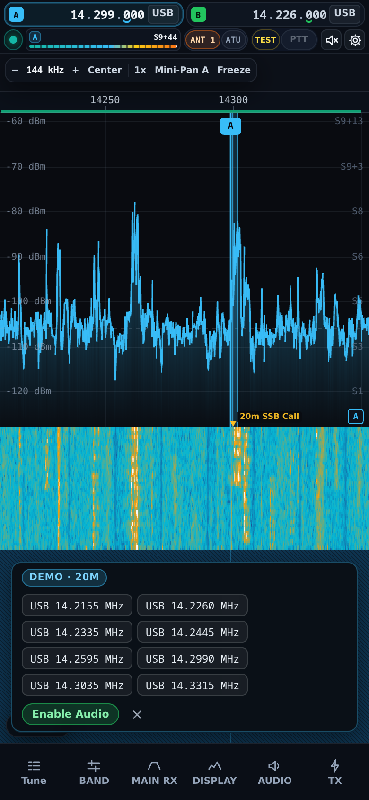
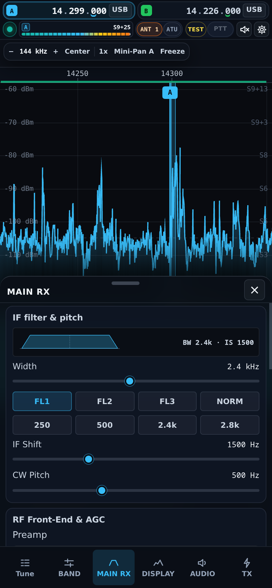
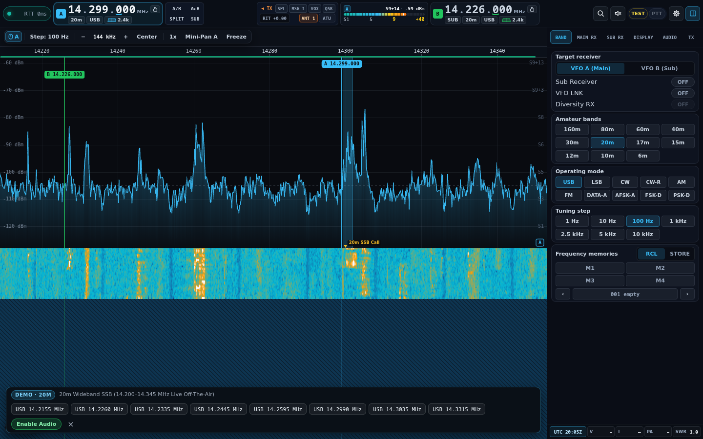

# k4-js — Elecraft K4 Browser Client

A zero-dependency, pure client-side browser panadapter, waterfall, decoded-text ticker, CAT control deck, and stereo Web Audio (`EM0`/`EM1` PCM + `EM2`/`EM3` Opus) interface for the **Elecraft K4** transceiver over its native TCP `:9205` protocol.

- **Zero Node.js / Zero build step**: Pure HTML, CSS, and classic deferred ES scripts (`globalThis.K4`).
- **Works on `file://` and `http(s)://`**: Includes pure-`BigInt` FIPS 180-4 SHA-384 auth, `ScriptProcessorNode` audio fallback, and `Canvas2D` waterfall fallback when WebGL2 or SecureContext APIs (`crypto.subtle`, `AudioWorklet`, `AudioDecoder`) are absent.
- **Receive-Only by Default, Hold-PTT Capable**: `K4.RxOnlyGate` defaults every session to `'rx-only'` (blocking TX, tune, keyer, DVR, power, and outbound `0x01` audio frames) until explicitly armed for TX Test or Hold-PTT operation.
- **Installable Mobile PWA with Background Auto-Updates**: Over `https://` or `http://localhost`, install to your phone Home Screen (`manifest.webmanifest`) and let `sw.js` + `K4.PwaManager` silently precache server updates in the background and reload safely once idle (never interrupting active TX or ATU tuning).
- **Self-Contained Live Band Demo (Zero Backend)**: Includes an in-browser virtual K4 transport (`K4.DemoSocket`) and quadrature DDC SDR demodulator (`K4.DemoDemodulator`) capable of playing real multi-tile off-the-air I/Q recordings directly from static hosting (GitHub Pages / Cloudflare Pages).

---

## Live Interactive Demo

Try `k4-js` immediately in your browser—no radio or backend server required:

**[Launch Live 20m SSB Demo → `https://pgenera.github.io/k4-js/`](https://pgenera.github.io/k4-js/)**

The hosted demo streams a real off-the-air **162 kHz wideband 20m SSB** recording (`14.200–14.362 MHz`, 9 stitched `20.25 kHz` KiwiSDR I/Q tiles) through an in-browser FFT + Weaver DDC demodulator in strict receive-only mode. Click **Enable Audio**, then click or drag anywhere on the panadapter/waterfall to tune live SSB voices, adjust `BW`/`IS` filters, or toggle `SUB` RX.

### Screenshots

**Mobile (`390×844` PWA)**

<table>
  <tr>
    <td></td>
    <td></td>
  </tr>
</table>

**Desktop (`1440×900`)**



### Capturing Your Own Demo Band (KiwiSDR)

Replace the bundled demo recording with any live HF band slice using the zero-dependency capture and prep scripts:

```bash
# Sweep ~145 kHz across 20m SSB over a single persistent KiwiSDR connection
python3 scripts/capture_kiwisdr.py \
  --hosts w7dq.proxy.kiwisdr.com:8073,kb6c.proxy.kiwisdr.com:8073 \
  --start-khz 14200 --span-khz 145 --step-khz 18 --duration 12 \
  --out-dir /tmp/20m_sweep

# Align noise floors across tiles, crossfade loop seams, and generate web/demo/
python3 scripts/prepare_demo_band.py \
  --sweep /tmp/20m_sweep/sweep.json \
  --band 20m --title "20m Wideband SSB (Live Off-The-Air)" \
  --out-dir web/demo
```

Pushes to `main` automatically redeploy `web/` to GitHub Pages via [`.github/workflows/deploy-demo.yml`](.github/workflows/deploy-demo.yml) (and `web/_headers` is included for zero-config Cloudflare Pages hosting).

---

## Quickstart (`file://` Dev Mode with Simulator)

1. Start the Go K4 TCP simulator (`127.0.0.1:19205`) and `websockify` (`127.0.0.1:9280`):

```bash
./scripts/dev.sh
```

2. Open directly in Firefox or Chromium:

```text
file:///path/to/k4-js/web/index.html
```

3. Click **Connect** (pre-filled with `ws://127.0.0.1:9280`; leave password empty for unauthenticated sim or pass `--password secret` to `dev.sh`).

### Serving over HTTP (`--serve`)

```bash
./scripts/dev.sh --serve
```

Then open `http://127.0.0.1:9280/` (auto-selects `ws://127.0.0.1:9280/ws`).

---

## Connecting to a Real Elecraft K4

Forward a local WebSocket port to `<k4-ip>:9205` using either `websockify` or `websocat`:

```bash
# Option A: websockify (expects Sec-WebSocket-Protocol: binary)
websockify 127.0.0.1:9280 <k4-ip>:9205

# Option B: websocat with explicit binary subprotocol
websocat -E -b --websocket-protocol binary ws-l:127.0.0.1:9280 tcp:<k4-ip>:9205
```

Then open `web/index.html`, enter your K4 network password (hashed locally via SHA-384 to 96 lowercase hex bytes before leaving the browser), and click **Connect**.

---

## Production Deployment (Reverse Proxy + systemd)

1. Copy static assets from `web/` to `/var/www/k4/`.
2. Install either [deploy/k4-websockify.service](deploy/k4-websockify.service) or [deploy/k4-websocat.service](deploy/k4-websocat.service) to `/etc/systemd/system/`, set `K4_HOST` in `/etc/default/k4-bridge`, and enable/start it.
3. Configure your TLS reverse proxy (e.g., Caddy) to serve `/var/www/k4/` on `/` and reverse-proxy WebSocket upgrades on `/ws` to `127.0.0.1:9280`.

---

## Running Verification Suites

### 1. Go Simulator Unit & Integration Tests (`go test`)

```bash
cd sim && go test -v -race ./...
```

Zero external Go modules are required; on Linux CGO builds `k4sim` loads `libopus.so.0` at runtime via `dlopen` for `EM2`/`EM3` Opus streaming and automatically falls back to `EM1` S16LE PCM under `CGO_ENABLED=0` or when `libopus.so.0` is absent.

### 2. Browser Unit Tests (Zero Node, works over `file://`)

Open `file:///path/to/k4-js/web/test.html` in Firefox or Chromium. Results render in the page and populate `window.__K4_TEST_RESULTS__`.

### 3. Headless Firefox & Hardware-Parity Verification (Python 3 stdlib + Marionette)

```bash
python3 tests/e2e_verify.py
```

Tests both `file:///path/to/k4-js/web/index.html` and `http://127.0.0.1:<port>/`, verifies auth, state hydration (`RDY;`/`AI4`/`AI5`), live spectrum/waterfall rendering (`0x02` PAN `centerFreqHz == FA` and `0x03` MiniPAN `±cwPitchHz` shift, 5-tier `#SPN` hysteresis), click-to-tune (`FA` / CW `-500 Hz` offset / `Shift`+right-click `FB`), `Cmd/Ctrl+K` omnibar, `TB$` semicolon preservation, `RxOnlyGate` (`txBlockedViolations === 0`), zero console errors, and captures Desktop (`1440x900`) and Mobile (`390x844`) PNG screenshots. Offline regression against sanitized real-K4 (`R40.B1`) payloads can also be verified with `k4_hw_probe.py --spawn-sim` and headless WebCodecs `EM2`/`EM3` Opus replay.
